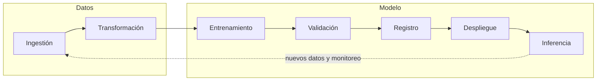

# 2. Ciclo de vida de los datos frente al ciclo de vida del modelo

En el data lifecycle los datos pasan por **ingestión, transformación y consumo**. En el ciclo de vida de un modelo esas etapas siguen ahí, pero el producto ya no es una tabla sino un modelo, y aparecen etapas nuevas: **entrenamiento, validación, registro, despliegue e inferencia**.

## Correspondencia etapa por etapa

| Data lifecycle | Ciclo de vida del modelo | Dónde aparece en este proyecto |
|---|---|---|
| Ingestión | Ingestión de los datos de entrenamiento | `load_breast_cancer()` en `clf-train.py` y `clf-train-registry.py` |
| Exploración y calidad | Entender el dato antes de modelar | `explore_data.py` (local) |
| Transformación | Preparación de features y división train/test | `train_test_split` y `StandardScaler` dentro del pipeline |
| (nuevo) | Entrenamiento | `model.fit(x_train, y_train)` |
| Validación de calidad del dato | Validación del modelo con métricas | `accuracy_train` y `accuracy_test` registradas en MLflow |
| Catálogo y linaje | Tracking y Model Registry | Runs en `my-experiment` y modelo registrado `clf-model` |
| Versionado de datasets | Versionado de modelos | Versiones 1, 2, ... de `clf-model` y alias `Staging` |
| Publicación para consumidores | Despliegue | Servicio `servemodel` con `mlflow models serve` |
| Consumo | Inferencia | `POST /invocations` con `predict.sh` |
| Monitoreo del pipeline | Monitoreo del modelo (drift, desempeño) | Fuera del alcance del taller |

## Qué se mantiene

- **Ingestión y transformación** siguen siendo los primeros pasos y su calidad define el resultado.
- **Reproducibilidad**: versiones fijas en `requirements.txt`, semilla `random_state=123` y el mismo entorno Docker para entrenar y servir.
- **Separación de entornos**: exploración local por un lado y ejecución reproducible en contenedores por el otro.

## Qué cambia

- **El producto**: ya no se publica una tabla sino un artefacto ejecutable que se consume como una API.
- **El consumo**: se envían datos nuevos y se recibe una predicción. El consumidor debe enviar las mismas columnas con las que se entrenó el modelo.
- **Cómo se mide la calidad**: en datos se valida completitud o formato; en modelos se mide el desempeño sobre datos que el modelo no vio (`accuracy_test`).
- **Las transformaciones viajan con el modelo**: el escalado aprendido en entrenamiento se aplica igual en inferencia porque está dentro del pipeline.

## Qué se amplía

- **Tracking de experimentos**: además de los datos, se guardan las métricas y artefactos de cada intento.
- **Model Registry**: un catálogo de modelos con versiones, descripción y alias.
- **Promoción**: registrar no es desplegar. Mover el alias `Staging` es la decisión de qué versión se sirve.
- **Serving**: aparece un servicio HTTP que hay que mantener disponible.
- **Monitoreo del modelo**: detectar cuándo los datos de producción cambian y reentrenar; es el siguiente paso hacia MLOps.

## El ciclo completo

